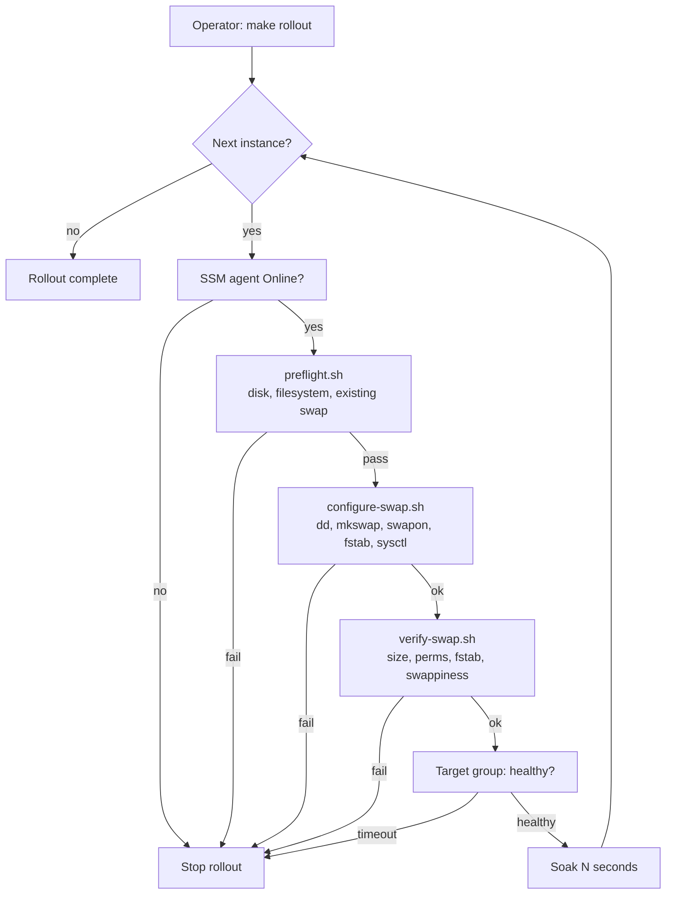

# ec2-rolling-swap-rollout

[](https://github.com/adijain-99/ec2-rolling-swap-rollout/actions/workflows/lint.yml)


Zero-downtime, rolling rollout of swap memory across a production EC2 fleet,
one instance at a time, through AWS Systems Manager. No SSH, no reboots, no
service restarts.

Includes idempotent host scripts, pre-flight and post-change gates, a
memory-safe rollback, CloudWatch monitoring, and the operational runbook used
to carry out the change by hand.

---

## Contents

- [Background](#background)
- [What this does](#what-this-does)
- [How it works](#how-it-works)
- [Repository layout](#repository-layout)
- [Prerequisites](#prerequisites)
- [Quick start](#quick-start)
- [Configuration](#configuration)
- [Safety model](#safety-model)
- [Verification](#verification)
- [Rollback](#rollback)
- [Monitoring](#monitoring)
- [Testing](#testing)
- [Limitations](#limitations)
- [Further reading](#further-reading)

---

## Background

A tier of application servers behind an Application Load Balancer was
running with **no swap at all**. Each node sat at roughly 75–80% memory use in
steady state, leaving a thin margin for traffic spikes, deploys or a slow
memory leak. Without swap, the first time a node ran out of memory the
kernel's OOM killer would terminate the largest process, which was the
application itself.

The goal was a **safety net, not a performance change**:

- Absorb short memory spikes instead of crashing.
- Keep the application's working set in RAM under normal load.
- Make the change on live production nodes with **no customer impact**.
- Leave the fleet in a state that survives reboots and is easy to audit and
  reverse.

## What this does

On each target host:

| Step | Action | Persisted via |
| --- | --- | --- |
| 1 | Creates an 8 GiB swap file at `/swapfile` (mode `0600`) | — |
| 2 | Formats and enables it (`mkswap`, `swapon`) | `/etc/fstab` |
| 3 | Sets `vm.swappiness=10` | `/etc/sysctl.d/99-swap.conf` |

Across the fleet, it applies those steps **one instance at a time**, gating
each host on pre-flight checks, post-change verification and load balancer
health before soaking and moving on.

## How it works



Scripts are shipped to each instance inline (base64) via the
`AWS-RunShellScript` document. What runs on the host is byte-for-byte what is
in this repository, with no S3 bucket, artefact store or SSH key involved.

The rollout is **fail-fast**: any non-zero exit stops the run before the next
host is touched. The fleet is never left with more than one host in an
unknown state.

## Repository layout

```text
.
├── scripts/
│   ├── preflight.sh            # read-only checks; gates the change
│   ├── configure-swap.sh       # idempotent: create, enable, persist, tune
│   ├── verify-swap.sh          # read-only post-change assertions
│   ├── rollback-swap.sh        # memory-safe removal
│   ├── rolling-rollout.sh      # fleet orchestration through SSM
│   └── build-ssm-document.sh   # generates ssm/configure-swap.yml
├── ssm/
│   └── configure-swap.yml      # SSM Command document (generated, do not edit)
├── monitoring/
│   ├── cloudwatch-agent.json   # memory, swap and disk metrics
│   └── README.md               # agent setup and suggested alarms
├── docs/
│   ├── runbook.md              # manual procedure with expected output
│   ├── design-decisions.md     # why each choice was made
│   ├── rollback.md             # how and when to roll back
│   └── change-record.md        # change request: risk, impact, sign-off
├── tests/
│   ├── test-rolling-rollout.sh # orchestration tests
│   └── mockbin/aws             # mock AWS CLI used by the tests
├── .github/workflows/lint.yml  # ShellCheck, yamllint, markdownlint, tests
├── Makefile
└── CHANGELOG.md
```

## Prerequisites

### Operator workstation

- AWS CLI v2 and `jq`
- IAM permissions: `ssm:SendCommand`, `ssm:GetCommandInvocation`,
  `ssm:DescribeInstanceInformation`, `ec2:DescribeInstances`,
  `elasticloadbalancing:DescribeTargetHealth`

### Target instances

- SSM agent running and the instance showing **Online** in Fleet Manager
  (instance role includes `AmazonSSMManagedInstanceCore`)
- Root filesystem `xfs` or `ext4`
- Free disk on `/` of at least swap size + 2 GiB headroom
- Tested on Amazon Linux 2023; works on other systemd-based distributions

### Before any production run

- An EBS snapshot of each target's root volume
- An approved change record (see [`docs/change-record.md`](docs/change-record.md))

## Quick start

```bash
git clone https://github.com/adijain-99/ec2-rolling-swap-rollout.git
cd ec2-rolling-swap-rollout

# 1. Dry run: pre-flight checks only, nothing changes
make preflight TAG=Role=app REGION=eu-west-1

# 2. Rolling rollout, waiting for ALB health between nodes
make rollout TAG=Role=app REGION=eu-west-1 \
  TG_ARN=arn:aws:elasticloadbalancing:eu-west-1:111122223333:targetgroup/app/0123456789abcdef

# 3. Confirm the end state across the fleet
make verify TAG=Role=app REGION=eu-west-1
```

Or target explicit instances, processed in the given order:

```bash
./scripts/rolling-rollout.sh \
  --instances i-0aaaaaaaaaaaaaaaa,i-0bbbbbbbbbbbbbbbb,i-0cccccccccccccccc \
  --region eu-west-1 \
  --soak-seconds 900
```

Prefer to do it by hand, or have no SSM access? Follow
[`docs/runbook.md`](docs/runbook.md). It is the same procedure, step by step,
with the expected output at each step.

## Configuration

| Variable / flag | Default | Description |
| --- | --- | --- |
| `SWAP_SIZE_MIB` / `--swap-size-mib` | `8192` | Swap file size |
| `SWAPPINESS` / `--swappiness` | `10` | `vm.swappiness` value |
| `SWAP_FILE` | `/swapfile` | Swap file path |
| `MIN_FREE_HEADROOM_MIB` | `2048` | Disk that must remain free after creation |
| `--soak-seconds` | `600` | Wait between instances |
| `--target-group-arn` | — | Wait for `healthy` after each instance |
| `--dry-run` | off | Pre-flight only |
| `--yes` | off | Skip the interactive confirmation |

Each run writes a full log to `logs/rollout-<timestamp>.log`.

## Safety model

| Risk | Mitigation |
| --- | --- |
| Writing 8 GiB evicts the app's page cache | `dd oflag=direct` bypasses the page cache |
| Swap file readable by other users | Created under `umask 077`, so it is `0600` from the first byte |
| `fallocate` file rejected by `swapon` on XFS | Uses `dd`, which writes real blocks |
| Broken `/etc/fstab` leaves the host unbootable | Backed up, validated with `mount -a`/`swapon -a`, auto-restored on failure |
| Re-running causes duplicates | Every step checks state first; second run is a no-op |
| A bad change spreads across the fleet | One host at a time, fail-fast, health-gated, soak between hosts |
| Root volume fills up | Pre-flight requires size + headroom free |
| `swapoff` on rollback triggers OOM | Rollback refuses unless free RAM exceeds swap in use + margin |

The reasoning behind each choice is in
[`docs/design-decisions.md`](docs/design-decisions.md).

## Verification

`verify-swap.sh` asserts, and exits non-zero on any mismatch:

- `/swapfile` is active with the expected size
- Permissions are `600 root:root`
- `/etc/fstab` contains **exactly one** entry for it
- `vm.swappiness` matches, both live and persisted

Expected output on a healthy host:

```text
[verify-swap] OK    /swapfile active (8388604 KiB)
[verify-swap] OK    Permissions 600 root:root
[verify-swap] OK    /etc/fstab has exactly one entry for /swapfile
[verify-swap] OK    vm.swappiness live value 10
[verify-swap] OK    vm.swappiness persisted in /etc/sysctl.d/99-swap.conf
[verify-swap] Summary: 0 failure(s)
```

## Rollback

```bash
make rollback TAG=Role=app REGION=eu-west-1
```

See [`docs/rollback.md`](docs/rollback.md) for when to roll back, what
`--force` does, and the manual commands.

## Monitoring

Memory and swap are guest-OS metrics, so CloudWatch only sees them with the
CloudWatch agent. [`monitoring/`](monitoring/) has the agent config, the
alarms worth setting, and how to tell harmless swap usage from active paging.

## Testing

```bash
make lint   # ShellCheck, yamllint, markdownlint, SSM document drift check
make test   # orchestration tests against a mock AWS CLI
```

CI also runs the host scripts end to end on a GitHub runner: create, re-run
(idempotency), verify, roll back, and confirm that verify then fails.

## Limitations

- **Auto Scaling Groups:** replacement instances will not have swap. For
  ASG-managed fleets, add `configure-swap.sh` to the launch template user
  data or bake it into the AMI.
- **Swap is a safety net.** If `swap_used_percent` stays high or `vmstat`
  shows sustained `si`/`so`, the instances need more RAM.
- **btrfs** is not supported (it needs a NOCOW swap file).
- **Instance store** volumes would be faster for swap but are ephemeral; this
  project uses the root EBS volume for simplicity and durability.

## Further reading

- [`docs/runbook.md`](docs/runbook.md): manual procedure
- [`docs/design-decisions.md`](docs/design-decisions.md): trade-offs
- [`docs/change-record.md`](docs/change-record.md): change management
- [`CHANGELOG.md`](CHANGELOG.md)

## License

[MIT](LICENSE)
